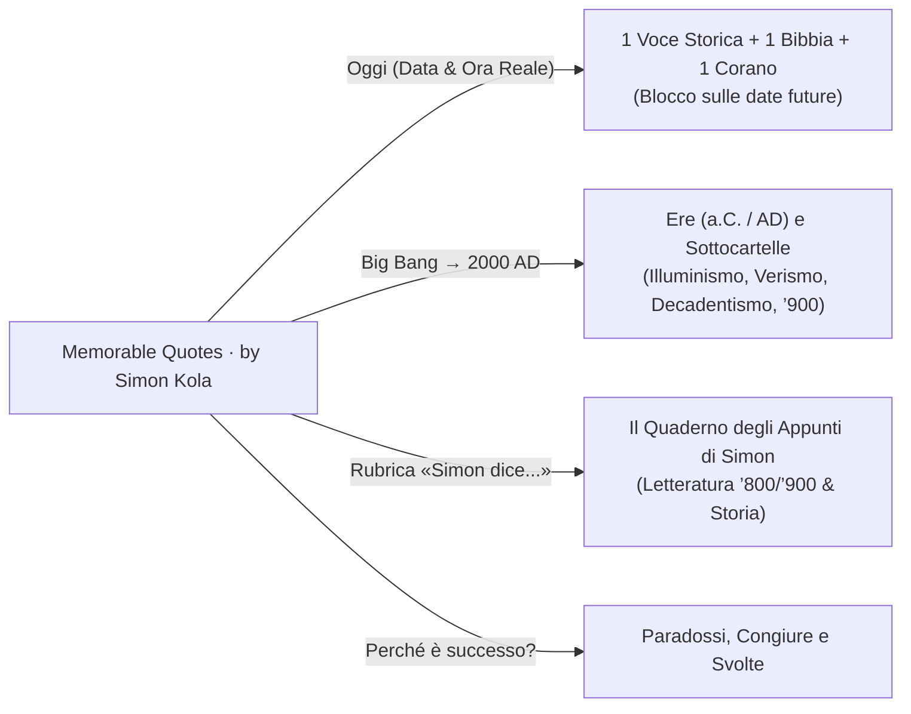

# Memorable Quotes · by Simon Kola

Applicazione web storico-filosofica, letteraria, politica e biblico-coranica firmata **by Simon Kola**: presenta ogni giorno un **Trittico** (1 voce storica/letteraria, 1 passo della **Bibbia** e 1 versetto del **Corano**) sincronizzato con l'orologio e la data reale, un **albero cronologico dal Big Bang al 2000 AD** diviso per sottocartelle, la sezione **Perché è successo?** e il **Quaderno degli Appunti di Simon («Simon dice...»)**.

Sito / Demo: **[https://simonkolaaa.github.io/MQ](https://simonkolaaa.github.io/MQ)** · GitHub: **[simonkolaaa](https://github.com/simonkolaaa)** · Progettazione visuale: **[docs/progettazione-uml-er.md](docs/progettazione-uml-er.md)** · Licenza: [MIT](LICENSE)

## Com'è fatto



- **Sfondo Costellazioni 3D & Intro Full-Screen Unica per Sessione**: [src/components/WebGLEditorialCanvas.tsx](src/components/WebGLEditorialCanvas.tsx) disegna uno spazio pulito di stelle e costellazioni 3D che accelera in un **fascio veloce di luce** durante la navigazione tra i pianeti; [src/components/CinematicIntroExperience.tsx](src/components/CinematicIntroExperience.tsx) mostra una sola volta all'apertura (fino al refresh della pagina) il preloader **made by Simon Kola** e 4 slide a tutto schermo navigabili con la rotellina del mouse.
- **Il Sistema Solare del Pensiero (con Zoom nel Pianeta, Route Dedicate e Touchpad Back)**: in [src/components/AuthorsAtlasSection.tsx](src/components/AuthorsAtlasSection.tsx), sotto il riquadro della *Mappa del Pensiero*, tutti gli argomenti e la sezione **Ideologie** ruotano come piccoli pianeti con l'immagine del protagonista. Cliccando su un pianeta, la telecamera zooma fisicamente dentro quel pianeta (`#/pianeta/<id>`) ed è possibile tornare indietro sia col pulsante dedicato sia con la **freccia Indietro del browser** o **scorrendo a due dita sul touchpad**.
- **Ideologie Spiegate Semplici**: in [src/data/ideologies.ts](src/data/ideologies.ts) sono raccolti **Socialismo, Comunismo, Capitalismo, Liberalismo, Anarchismo, Conservatorismo, Nazionalismo e Fascismo**, spiegati in modo divertente (con le metafore della pizzeria, del condominio e delle due mucche) e approfondibili in modo autonomo.
- **Trittico Giornaliero con Data e Ora Reale**: la Home mostra l'ora attuale in tempo reale e propone ogni giorno una voce storica/letteraria, un passo della **Bibbia** e un versetto del **Corano**.
- **Albero Cronologico dal Big Bang al 2000 AD con Sottocartelle**: in [src/components/AuthorsAtlasSection.tsx](src/components/AuthorsAtlasSection.tsx) i filosofi, i poeti e gli autori sono ordinati per Era (`a.C.` / `AD`) e Sottocartella tematica.
- **Il Quaderno degli Appunti di Simon («Simon dice...»)**: in [src/components/SimonNotesSection.tsx](src/components/SimonNotesSection.tsx) e [src/data/simonNotes.ts](src/data/simonNotes.ts) sono raccolti, ordinati e rielaborati gli appunti di Simon su Letteratura dell'Ottocento e del Novecento, Storia contemporanea (da Owen, Marx e Bismarck fino a Giolitti, Prima Guerra Mondiale, Fascismo, Repubblica di Weimar e Seconda Guerra Mondiale) e laboratorio di argomentazione, collegati direttamente alle schede dei poeti.
- **Sezione *"Perché è successo?"* con Ironia, Metafore e Ripercussioni nel Presente**: raccoglie in [src/components/HistoricalInquiriesSection.tsx](src/components/HistoricalInquiriesSection.tsx) casi curiosi e magnetici dal Big Bang al 2000 AD.

## Setup e sviluppo locale

Richiede **Node.js 20+** e **npm**.


## Struttura del progetto

```text
.
|- docs/
|  '- progettazione-uml-er.md            # Diagrammi Mermaid dell'albero cronologico e delle sottocartelle
|- public/
|  '- 404.html                           # Fallback GitHub Pages
|- src/
|  |- components/
|  |  |- WebGLEditorialCanvas.tsx          # Shader WebGL GLSL interattivo (parallasse mouse, scroll e tema)
|  |  |- CinematicIntroExperience.tsx      # Preloader "made by Simon Kola" + Intro scrollytelling orizzontale
|  |  |- AuthorPortrait.tsx                # Ritratto/Fotografia dei personaggi storici
|  |  |- AuthorsAtlasSection.tsx         # Linea del Tempo (Big Bang → 2000 AD), Sottocartelle e Collegamenti
|  |  |- HistoricalInquiriesSection.tsx  # Sezione "Perché è successo?" con paradossi e ripercussioni oggi
|  |  |- SimonNotesSection.tsx           # Il Quaderno degli Appunti di Simon («Simon dice...») e Preferiti
|  |  |- QuoteBentoSheet.tsx             # Scheda Bento con traduttore multilingua
|  |  '- AddCustomQuoteModal.tsx         # Modale per aggiungere citazioni personali
|  |- core/
|  |  |- types.ts                        # Modelli di dominio TypeScript
|  |  |- quoteEngine.ts                  # Selezione giornaliera (Storia + Bibbia + Corano) e filtri
|  |  '- quoteEngine.test.ts             # Unit test Vitest
|  |- data/
|  |  |- seeds.ts                        # Ere, Sottocartelle, Autori e Casistiche
|  |  '- simonNotes.ts                   # Appunti scolastici di Simon rielaborati e collegati ai poeti
|  |- services/
|  |  '- liveWikiApi.ts                  # Client dinamico con sintesi agili e caching locale
|  |- state/
|  |  '- useCollection.ts                # Persistenza in localStorage
|  |- App.tsx                            # Shell principale dell'applicazione
|  '- index.css                          # Design system Awwwards
'- .github/workflows/deploy.yml          # CI/CD automatico per GitHub Pages
```

## Messa in produzione (Deploy)

Il workflow `.github/workflows/deploy.yml` esegue automaticamente i test (`npm test`), compila il bundle (`npm run build`) e pubblica la cartella `./dist` su **GitHub Pages** ad ogni push sul branch `main`.
