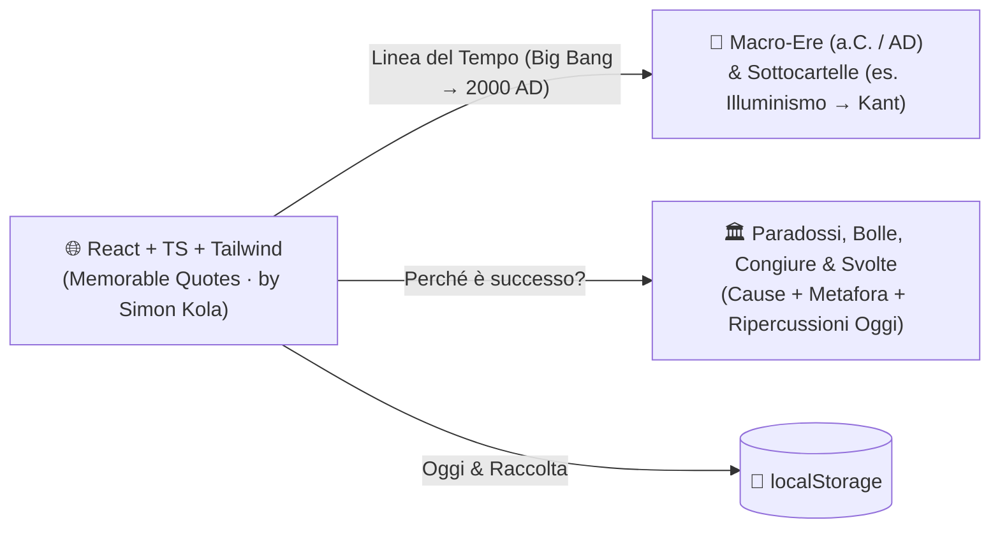

# Memorable Quotes · by Simon Kola

Applicazione web storico-filosofica, letteraria, politica e biblico-coranica che organizza il pensiero e i fatti lungo un **filo logico cronologico dal Big Bang al 2000 AD**, con sottocartelle tematiche (es. *Illuminismo*, *Stoicismo*, *Il Martello di Nietzsche*), collegamenti diretti tra pensatori e racconti brillanti arricchiti da metafore e ironia.

Sito / Demo: **[https://memorable-quotes.github.io](https://memorable-quotes.github.io)** · Progettazione visuale: **[docs/progettazione-uml-er.md](docs/progettazione-uml-er.md)** · Licenza: [MIT](LICENSE)

## Com'è fatto



- **Albero Cronologico con Sottocartelle e Collegamenti (Dal Big Bang al 2000 AD)**: nella sezione **Filosofi, Autori & Studia** ([src/components/AuthorsAtlasSection.tsx](src/components/AuthorsAtlasSection.tsx)) tutti i personaggi sono ordinati per **Era Storica (`a.C.` / `AD`)** e raggruppati in **Sottocartelle tematiche** (es. *L'Illuminismo & L'Età della Ragione* con i collegamenti tra *Voltaire*, *Rousseau* e *Immanuel Kant*, *L'Età d'Oro di Atene* con *Socrate → Platone → Aristotele*, *Cinismo e Stoicismo Imperiale* da *Diogene* a *Marco Aurelio*, *Il Martello della Filosofia* con *Friedrich Nietzsche*).
- **Stile Narrativo Agile, Metaforico e Satirico**: ogni pensatore e ogni fatto storico presenta un ritratto senza filtro (*"Il Personaggio senza filtro"* / *"Il Paradosso in una frase"*) che usa ironia, aneddoti reali e metafore per agganciare il lettore senza appesantire la lettura.
- **Sezione *"Perché è successo?"* Variata dal Big Bang al 2000 AD**: raccoglie in [src/components/HistoricalInquiriesSection.tsx](src/components/HistoricalInquiriesSection.tsx) i casi più curiosi e magnetici della storia (*Dal Big Bang al Lunedì Mattina*, *Dalla Bolla dei Tulipani a Wall Street*, *L'Autogol delle Idi di Marzo*, *La Rivoluzione Francese*, *L'Errore di Svolta dell'Autista a Sarajevo nel 1914*, *Il Falso Allarme Nucleare del 1983*, *Lo Scandalo Watergate*, *Černobyl'*, *La Banalità del Male*, *Tangentopoli*).
- **Traduzione in tempo reale (Latino, Inglese, Francese, Tedesco)**: ogni citazione può essere letta in più lingue, con testo originale per i passi della **Bibbia** e del **Corano**.

## Setup e sviluppo locale

Richiede **Node.js 20+** e **npm**.

### Comandi principali
```bash
npm install          # installa le dipendenze
npm run dev          # avvia il server di sviluppo su http://localhost:5173
npm test             # esegue i test automatici con Vitest
npm run build        # compila la build statica di produzione in ./dist
```

## Struttura del progetto

```text
.
|- docs/
|  '- progettazione-uml-er.md            # Diagrammi Mermaid dell'albero cronologico e delle sottocartelle
|- public/
|  '- 404.html                           # Fallback GitHub Pages
|- src/
|  |- components/
|  |  |- AuthorPortrait.tsx              # Ritratto/Fotografia dei personaggi storici
|  |  |- AuthorsAtlasSection.tsx         # Linea del Tempo (Big Bang → 2000 AD), Sottocartelle e Collegamenti
|  |  |- HistoricalInquiriesSection.tsx  # Sezione "Perché è successo?" con paradossi e ripercussioni oggi
|  |  |- QuoteBentoSheet.tsx             # Scheda Bento con traduttore multilingua
|  |  '- AddCustomQuoteModal.tsx         # Modale per aggiungere citazioni personali
|  |- core/
|  |  |- types.ts                        # Modelli di dominio TypeScript
|  |  |- quoteEngine.ts                  # Ordinamento cronologico, filtri per sottocartella e ricerca
|  |  '- quoteEngine.test.ts             # Unit test Vitest
|  |- data/
|  |  '- seeds.ts                        # Ere, Sottocartelle (SUBFOLDER_MOVEMENTS), Autori e Casistiche
|  |- services/
|  |  '- liveWikiApi.ts                  # Client dinamico con sintesi agili e caching locale
|  |- state/
|  |  '- useCollection.ts                # Persistenza in localStorage
|  |- App.tsx                            # Shell principale dell'applicazione
|  '- index.css                          # Design system Awwwards
'- .github/workflows/deploy.yml          # CI/CD automatico per GitHub Pages
```

## Messa in produzione (Deploy)

Il workflow `.github/workflows/deploy.yml` esegue automaticamente i test (`npm test`), compila il bundle (`npm run build`) e pubblica la cartella `./dist` su **GitHub Pages** ad ogni push sul branch `main`.
