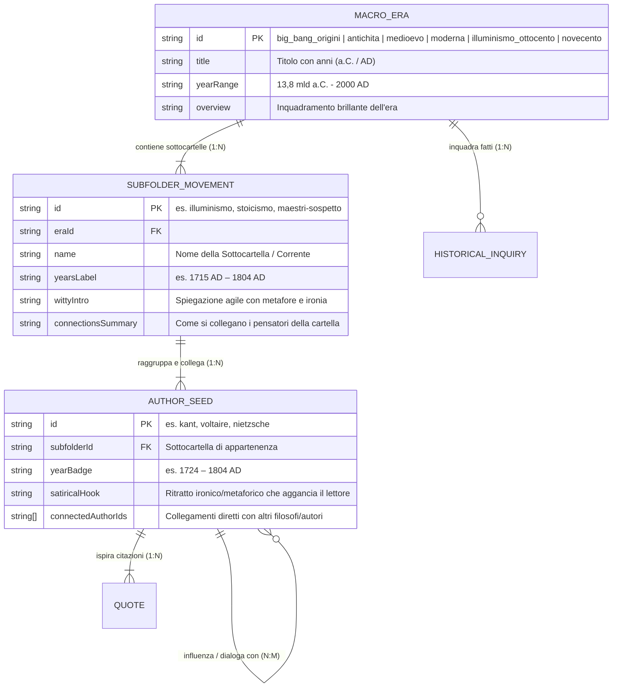

# 🏛️ Progettazione Visuale — *Memorable Quotes · by Simon Kola*

Questo documento raccoglie i diagrammi architetturali del progetto aggiornati con:
1. **Albero Cronologico Coerente dal Big Bang al 2000 AD**: organizzazione di filosofi e autori in **Macro-Ere Cronologiche (a.C. / AD)** e **Sottocartelle Tematiche / Correnti** (es. *Illuminismo*, *Stoicismo*, *Esistenzialismo*, *Maestri del Sospetto*), con mappa dei **collegamenti diretti** tra autori (es. *Rousseau / Voltaire $\rightarrow$ Kant*, *Schopenhauer $\rightarrow$ Nietzsche*).
2. **Stile Narrativo Brillante, Metaforico e Satirico**: spiegazioni agili, mai prolisse, arricchite da metafore, ironia e paradossi storici per agganciare subito il lettore.
3. **Sezione *"Perché è successo?"* Variata dal Big Bang al 2000**: casistica ampia e curiosa (cosmologia, bolle speculative dai tulipani a Wall Street, Idi di Marzo, svolta sbagliata di Sarajevo, Watergate, Černobyl', Guerra Fredda, Prima Repubblica) con cause, racconto agile e ripercussioni nel presente.

---

## 1. Albero Cronologico di Filosofi e Autori (Dal Big Bang al 2000 AD)

```mermaid
flowchart TD
    Root(["🌌 Linea del Tempo: Dal Big Bang al 2000 AD"])
    Root --> E0["1. Dal Big Bang all'Alba delle Civiltà\n(13,8 mld a.C. – VIII sec. a.C.)"]
    Root --> E1["2. Antichità Classica\n(VI sec. a.C. – II sec. AD)"]
    Root --> E2["3. Tardo Antico e Medioevo\n(300 AD – 1400 AD)"]
    Root --> E3["4. Rinascimento e Rivoluzione Scientifica\n(1400 AD – 1700 AD)"]
    Root --> E4["5. Illuminismo, Romanticismo e Crisi dell'800\n(1700 AD – 1900 AD)"]
    Root --> E5["6. Il Novecento fino al 2000 AD\n(1900 AD – 2000 AD)"]

    E0 --> F0A["📁 Cosmogonia & Dal Mito al Logos\n(Omero)"]
    E1 --> F1A["📁 Presocratici & Scuola Ionica\n(Eraclito)"]
    E1 --> F1B["📁 Età d'Oro di Atene & Tragedia\n(Socrate → Platone → Aristotele, Sofocle)"]
    E1 --> F1C["📁 Cinismo & Stoicismo Imperiale\n(Diogene, Seneca, Epitteto → Marco Aurelio)"]
    E2 --> F2A["📁 Tramonto di Roma & Patristica\n(Ipazia, Agostino, Boezio)"]
    E2 --> F2B["📁 Amor Cortese & Dolce Stil Novo\n(Tristano e Isotta → Dante Alighieri)"]
    E3 --> F3A["📁 Umanesimo, Arte & Realismo Politico\n(Leonardo, Michelangelo, Machiavelli)"]
    E3 --> F3B["📁 Cosmo Infinito & Razionalismo\n(Giordano Bruno → Spinoza, Shakespeare, Pascal)"]
    E4 --> F4A["📁 Sottocartella: L'Illuminismo (1715-1804 AD)\n(Voltaire & Rousseau → Immanuel Kant)"]
    E4 --> F4B["📁 Pessimismo & Abisso Esistenziale\n(Schopenhauer, Leopardi, Kierkegaard, Dostoevskij)"]
    E4 --> F4C["📁 Il Martello della Filosofia\n(Friedrich Nietzsche)"]
    E5 --> F5A["📁 Coscienza Civile & Testimoni del '900\n(Gramsci, Simone Weil, Arendt, Primo Levi)"]
    E5 --> F5B["📁 Disillusione, Satira & Potere Contemporaneo\n(Cioran, Pasolini, Moro, Falcone, Craxi)"]
```

---

## 2. Diagramma Entità-Relazione (ER) — Ere, Sottocartelle e Collegamenti

